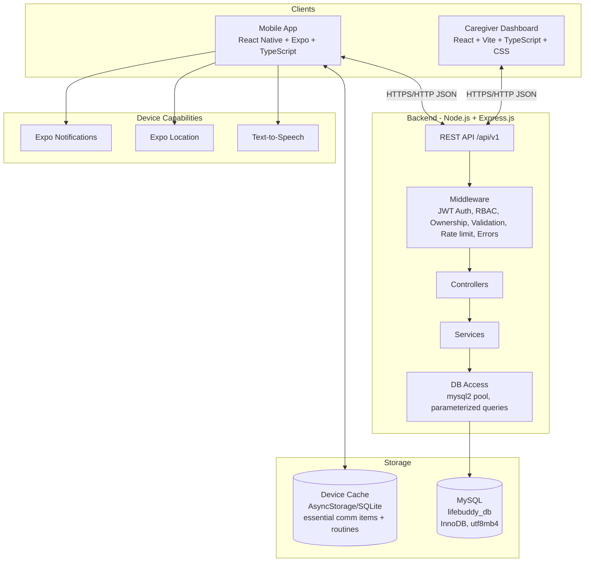
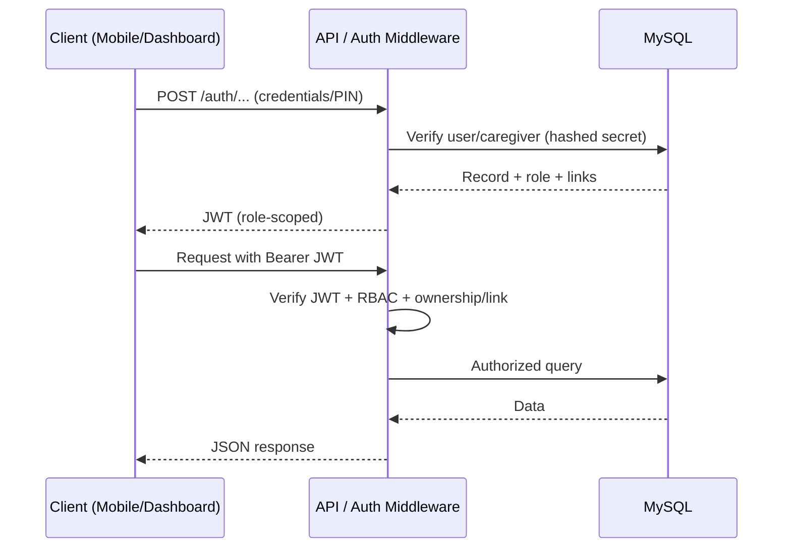

# Life Buddy — System Architecture

## 1. Architectural overview
Life Buddy uses a **client–server** architecture with three deployable/runnable applications sharing one backend and one MySQL database.



**Authoritative data:** MySQL. **Device cache:** convenience/offline for essential content only; server wins on conflicts where applicable.

## 2. Component responsibilities

| Component | Responsibilities | Key tech |
|---|---|---|
| **Mobile app** | Accessible UI for assisted user; communication + TTS; routines/medicines/emotions/situations; SOS initiation; local caching & sync; permissions (location/notifications); simplified PIN auth/session | React Native, Expo, TS, Expo Router/Navigation, TTS, Expo Notifications/Location, AsyncStorage/SQLite, i18n |
| **Caregiver dashboard** | Secure management & monitoring; CRUD for users/links/preferences/routines/medicines/contacts; SOS & activity views with accurate statuses; responsive accessible UI | React, Vite, TS, CSS |
| **Backend** | REST API, auth (JWT), RBAC/ownership, validation, business logic, SOS record + notification orchestration + delivery status, consistent errors, health check | Node.js, Express, mysql2, bcrypt, JWT, validation, helmet/cors |
| **Database** | Persistent relational storage, integrity, constraints/indexes, demo-safe seeds | MySQL `lifebuddy_db` |

## 3. Module boundaries (domain features)
- **Auth & identity:** caregiver login (email/password), user PIN access, tokens/sessions, role & link enforcement.
- **Users & links:** profiles, `caregiver_links` (authorization boundary), preferences.
- **Communication:** `communication_items`, sentence composition rules (deterministic), `favourite_phrases`.
- **Routines:** `routines`, ordered `routine_steps`, `routine_completions` (+ offline queue/sync semantics).
- **Medicines:** `medicines`, `medicine_reminders`, `medicine_logs` (Taken/Skipped).
- **Contacts & SOS:** `emergency_contacts`, `sos_alerts` (status lifecycle, coords, delivery outcome, acknowledgement).
- **Situations:** predefined `situation_steps` (deterministic, DB-backed).
- **Activity:** `activity_logs` (where useful) and derived views for dashboard.
- **Devices (optional):** `device_tokens` for Expo Push integration when configured.

## 4. Data flow (key scenarios)

### 4.1 Authentication & authorization

- Caregiver: email+password (bcrypt). User: PIN (bcrypt-hashed server-side). Every protected operation validates ownership/link.

### 4.2 Communication (TALK)
1. Mobile fetches communication items/favourites from API (and caches essential items locally).
2. User selects tiles → app composes sentence deterministically → displays and speaks via TTS (replay supported).
3. Save favourite → API → MySQL; load favourites from API/cache as available.

### 4.3 Routines (MY DAY) with offline
1. Caregiver manages routines/steps in dashboard → API → MySQL.
2. Mobile syncs assigned routines; caches essential routines for offline viewing.
3. Step completion: if online, persist to MySQL immediately; if offline, store completion event locally as **pending** and sync when connected (sensible conflict handling; no silent overwrite of newer server data).

### 4.4 Medicine reminders
1. Caregiver configures medicines/reminders → MySQL.
2. Mobile fetches schedules, shows upcoming, triggers local notifications/voice where supported/enabled.
3. User marks Taken/Skipped → API → `medicine_logs` in MySQL; history viewed from server-backed data (sync when connectivity permits).

### 4.5 SOS alert (critical, honest status)
```mermaid
sequenceDiagram
  participant U as Mobile User
  participant App as Mobile App
  participant API as Backend
  participant DB as MySQL
  participant CG as Caregiver Dashboard

  U->>App: Tap SOS
  App->>U: Confirm / Cancel
  App->>App: Request/check location (may be denied/unavailable)
  App->>API: POST SOS (user, coords|null, context)
  API->>DB: INSERT sos_alert (status=Created/Pending...)
  API->>API: Attempt notification (DB-backed dashboard alert; optional push if configured)
  API->>DB: UPDATE delivery/notification status (e.g. Sent/Failed)
  API-->>App: Alert record + accurate status
  CG->>API: GET SOS alerts (authorized, linked users)
  API->>DB: SELECT
  DB-->>API: Alerts
  API-->>CG: Display (incl. status, map link if coords)
  CG->>API: Acknowledge
  API->>DB: Record acknowledgement time + caregiver
```
- **Offline device:** cannot transmit; app must explain failure (no false success). **No external delivery claim** without confirmation.

### 4.6 Situations (HELP ME)
- Mobile fetches predefined situation steps from API/MySQL (cacheable if appropriate) and guides step-by-step with TTS/repeat; fully functional without AI.

## 5. API architecture
- **Base:** `/api/v1`, RESTful JSON, consistent response envelope and error format, meaningful HTTP status codes.
- **Groups:** auth, users, caregiver-links, preferences, communication-items, favourite-phrases, routines, routine-steps, routine-completions, medicines, medicine-reminders, medicine-logs, emergency-contacts, sos-alerts (+ acknowledge), situation-instructions, activity-logs.
- **Cross-cutting:** request validation, JWT auth, RBAC, ownership checks, pagination/filtering on lists, parameterized SQL, centralized error/not-found handling, auth rate limiting, helmet/CORS.
- **Documentation:** `docs/api.md` (method, endpoint, purpose, auth, params, example req/res, errors).

## 6. Database architecture (logical)
- **Engine/config:** MySQL `lifebuddy_db`, InnoDB, utf8mb4.
- **Integrity:** PK/FK relationships, unique constraints, indexes on frequent filters/joins (e.g. user_id, caregiver link pairs, schedules, statuses, timestamps), normalized design, timestamps, appropriate ON DELETE behavior.
- **Core entities:** users, caregiver_links, user_preferences, routines/routine_steps/routine_completions, medicines/medicine_reminders/medicine_logs, emergency_contacts, sos_alerts, communication_items, favourite_phrases, situation_steps, (optional) device_tokens, activity_logs.
- **Artifacts:** `database/schema/lifebuddy_schema.sql`, `database/seed/demo_data.sql`, `database/queries/sample_crud.sql`, `database/erd/` + explanations in `docs/database.md`.
- Detailed physical schema/ERD delivered in **Phase 2**.

## 7. Security architecture
- Secrets in `.env` (see `.env.example` placeholders only); never committed.
- Passwords and PINs hashed with **bcrypt** (server-side only); no plaintext storage.
- **JWT** for authenticated sessions; protected routes; **RBAC** (`caregiver`,`user`) + per-resource ownership/link checks.
- Input validation/sanitization; **parameterized SQL** only; rate limiting on auth endpoints; helmet and suitable CORS.
- Sensitive data (medicine, contacts, SOS/location) access-restricted; location shared only as needed and authorized.

## 8. Offline & synchronization strategy
- **Cached on device (essential):** communication pictures/items and assigned routines for offline access.
- **State clarity:** UI distinguishes locally available, pending synchronization, server-synchronised, and failed sync.
- **Sync rules:** queue offline-completable events (e.g. routine completion) and push when online; medicine history and SOS records synchronized when connectivity permits; **SOS cannot be falsely shown as delivered while offline**.
- **Conflicts:** prefer server as source of truth; apply sensible merge/retry rules; never silently overwrite newer server records.

## 9. Deployment / runtime (development & demo)
- **Mobile:** Expo dev server; run on emulator or physical device (TTS/notifications/location behavior validated on supported device/emulator).
- **Dashboard:** Vite dev/build served locally for demo.
- **Backend:** Node/Express process with `.env` config pointing to local MySQL instance.
- **Database:** local MySQL server hosting `lifebuddy_db` (setup scripts applied manually/CLI/Workbench as available). External deployment not required.

## 10. Risks, constraints, and mitigations
| Risk/constraint | Impact | Mitigation |
|---|---|---|
| MySQL CLI not on PATH / env variance | Schema apply & connectivity tests delayed | Provide `.sql` scripts and `.env.example`; document Workbench/PowerShell steps; verify connection in Phase 3 |
| Node/Expo version compatibility | Init/build issues | Select stable, compatible dependency versions; lock and test incrementally |
| SOS external delivery unconfirmable | Risk of false claims | DB-backed baseline + explicit delivery statuses; enable push only with valid config/tokens; honest UI |
| Offline conflict/duplication | Data inconsistency | Pending queue, idempotency where possible, server timestamps, no silent overwrite |
| Accessibility regressions | Poor usability | Centralized settings, reusable components, consistent testing of labels/contrast/TTS/reduced motion |
| Scope creep | Incomplete core | Prioritize working core modules, real persistence, and verified tests over optional AI/extras |

## 11. Phase alignment
Architecture is implemented incrementally: **P2** detailed UI/DB design, **P3** backend foundation/APIs, **P4-5** mobile, **P6** dashboard, **P7** integration, **P8** testing/verification, **P9** documentation/handover (see `docs/PROJECT_PROGRESS.md`).
