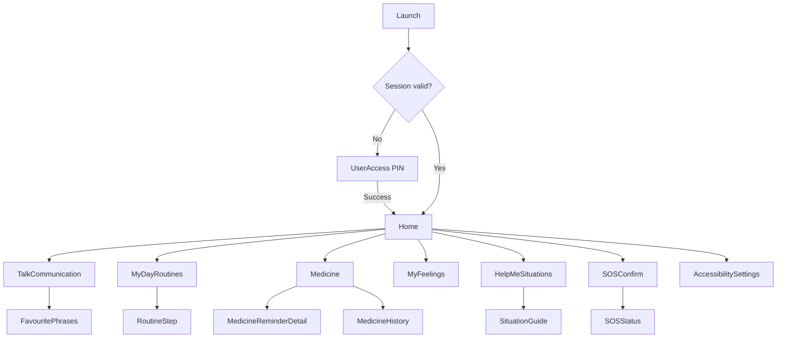
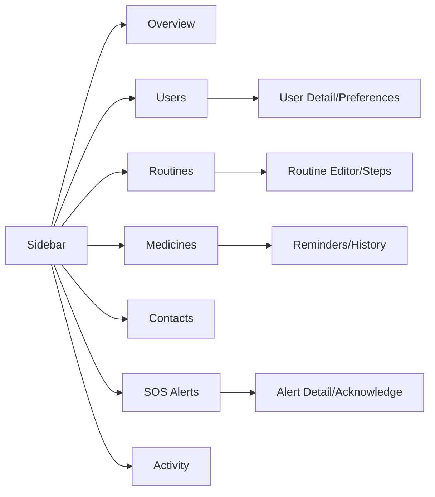

# Life Buddy — UI/UX Design Specification (Phase 2)

> **Purpose:** Precise, implementation-ready design for the **mobile app** (React Native + Expo + TypeScript) and **caregiver dashboard** (React + Vite + TypeScript + CSS), aligned with `docs/requirements.md` and `docs/architecture.md`.
> **Principles:** accessibility-first, simple/consistent navigation, minimal cognitive load, respectful & professional (not childish), bilingual (English/Bengali), honest system states (loading/empty/success/error/offline/sync).

## 1. Global design system

### 1.1 Visual identity (shared direction)
- **Tone:** calm, welcoming, safe, supportive, trustworthy.
- **Palette (accessible, consistent):** soft blue/teal primary actions, gentle green for success/confirm, warm neutral backgrounds, white surfaces/cards, dark readable text, distinct status colours (success/warning/error/info) meeting contrast needs. Avoid excessive gradients/shadows/random colours.
- **Typography:** clear sans-serif; base scale driven by accessibility setting (see 1.4). High line-height, no decorative fonts for critical content.
- **Iconography/imagery:** clear, meaningful icons or simple illustrations per action/tile/emotion/step; always paired with text labels (not icon-only for critical actions).
- **Layout:** generous spacing, consistent padding/margins, one primary focus per screen/step where possible.

### 1.2 Accessibility tokens & behavior (apply everywhere)
| Setting | Options | Behavior |
|---|---|---|
| Language | `en`, `bn` | Switch all UI strings, TTS language/voice selection, and bilingual content fields (prefer `*_bn` when `bn`, fallback `*_en`). No screen left untranslated. |
| Text size | `small`, `medium`, `large` (default), `xlarge` | Scales font tokens and reflows layout (no truncation of critical labels/messages). |
| Contrast mode | `normal`, `high` (default) | High contrast uses stronger foreground/background/status contrast and clearer borders/focus rings. |
| Speech rate | 0.5–2.0 (default 1.0) | Applied to all TTS playback (sentences, step instructions, reminders, emotion messages). |
| Voice assistance | on/off (default on) | When on, key instructions/messages can auto-announce (context-appropriate) and always support manual **Repeat**; when off, visual-only but Repeat/TTS controls remain available unless device unavailable. |
| Reduced motion | on/off (default off) | Disables non-essential animations/transitions; keeps instant state changes and focus feedback. |
| Notifications | on/off (default on) | Controls local reminder notifications where supported (permission-dependent). |

- **Touch targets:** minimum **48x48 dp** for all interactive elements; primary mobile actions and SOS significantly larger (full-width/large tiles).
- **Screen reader:** every interactive element has accessible label/role/hint; images/icons have meaningful labels or are hidden if decorative with adjacent text present; focus order logical; live announcements for generated sentence, step changes, alerts, and status messages.
- **Focus/feedback:** visible focus/pressed states (border/highlight/scale-safe), haptic optional, clear confirmation/error messages.
- **Consistency:** same placement for Back/Home/Repeat/Settings patterns; predictable navigation.

### 1.3 Localization (Bengali & English)
- **Resource model:** i18n keys for all static UI strings (`mobile/src/i18n/en.ts`, `bn.ts`; dashboard equivalent). Dynamic/domain content uses bilingual DB fields (`label_en/label_bn`, `instruction_en/bn`, `title_en/bn`, `phrase_en/bn`, etc.) with fallback to English.
- **Coverage (must include):** navigation labels, button text, form labels/placeholders/validation, headings, empty/loading/error/offline/sync states, confirmations, SOS status/messages, accessibility setting labels, notifications text, TTS strings.
- **Formatting:** numbers/dates/times rendered in locale-friendly form where practical; layout must accommodate longer Bengali text (no clipping).
- **Language switch:** immediate UI update; persisted in preferences (and synced to backend when online).

### 1.4 Standard UI states (all data-driven screens)
| State | When | UI behavior |
|---|---|---|
| **Loading** | Fetching/saving/syncing | Skeleton or simple spinner + short label (localized), focus-safe, no blank confusing screen |
| **Empty** | No records (e.g. no routines, no alerts) | Friendly illustration/icon + clear message + primary CTA where applicable (dashboard) |
| **Success** | Action completed/persisted | Non-intrusive confirmation (toast/banner) + updated data; TTS announce optional if voice on |
| **Error** | Request/validation/server failure | Clear localized message, cause where safe (no sensitive internals), **Retry** action, preserve user input |
| **Offline** | No connectivity | Persistent but unobtrusive indicator; show cached/locally available content where allowed; disable/guard actions that require server and explain why |
| **Pending sync** | Local change queued | Visible "Pending sync" badge/state per item or globally; auto-retry when online; show "Synced"/"Failed sync" outcome |
| **Permission denied/unavailable** | Location/notifications | Explain impact and how to proceed; continue safe fallback (e.g. SOS without coords) |

**Honesty rule:** never display "sent/delivered/success" for SOS or external notifications unless actually confirmed by the implemented mechanism and reflected in backend status.

---

## 2. Mobile application (React Native + Expo)

### 2.1 Screen list and navigation structure
**Navigation approach:** stack-based flow with a simple root (auth gate → main). Keep hierarchy shallow; back navigation always available except where confirmation required.

| ID | Screen/Route | Purpose | Entry points |
|---|---|---|---|
| M-AUTH | `UserAccess` | Simplified PIN access for assisted user | App launch when no valid session |
| M-HOME | `Home` | 6 primary actions hub | Auth success, app resume (session valid) |
| M-TALK | `TalkCommunication` | Picture tiles, selection, sentence, TTS, favourites | Home → TALK |
| M-FAV | `FavouritePhrases` | View/play saved phrases | Talk |
| M-DAY | `MyDayRoutines` | List assigned routines (cached) | Home → MY DAY |
| M-DAY-STEP | `RoutineStep` | One focused step with controls/progress | Routine list selection |
| M-MED | `Medicine` | Upcoming reminders + history entry | Home → MEDICINE |
| M-MED-DETAIL | `MedicineReminderDetail` | Reminder info, Taken/Skipped | Upcoming/history selection |
| M-MED-HIST | `MedicineHistory` | Taken/Skipped/missed records | Medicine |
| M-FEEL | `MyFeelings` | Emotion grid and message/TTS | Home → MY FEELINGS |
| M-HELP | `HelpMeSituations` | Situation list | Home → HELP ME |
| M-HELP-GUIDE | `SituationGuide` | Step-by-step guided instructions | Situation selection |
| M-SOS-CONFIRM | `SOSConfirm` | Confirm/cancel to avoid accidental activation | Home → SOS |
| M-SOS-STATUS | `SOSStatus` | Accurate alert/delivery status, contact, guidance | After SOS submit attempt |
| M-SET | `AccessibilitySettings` | Language, text, contrast, speech, voice, motion, notifications | Home (settings entry) / global access |

**Root flow:** `Launch → (session?) UserAccess : Home`. From `Home`, each primary module opens as a focused screen/stack; persistent "Home" affordance (header/back) to return. `SOSConfirm` is a modal or dedicated screen requiring explicit confirm/cancel.

(See also `docs/diagrams/mobile-screen-flow.mmd`.)

### 2.2 Home screen (M-HOME) — detailed layout
- **Header:** app name/logo mark "Life Buddy" (localized where appropriate) + small **Settings** icon button (to M-SET) and optional sync/offline indicator. High contrast, large text.
- **Welcome area:** short supportive greeting (localized), optional time-of-day; no clutter.
- **Primary action grid/list (6 large tiles/cards):** vertically scrollable grid (2 columns on typical phones, 1 column if `xlarge` text requires) with generous spacing.
  1. **TALK** (communication icon, e.g. chat/pictures) → M-TALK
  2. **MY DAY** (sun/checklist icon) → M-DAY
  3. **MEDICINE** (pill/clock icon) → M-MED
  4. **MY FEELINGS** (face/heart icon) → M-FEEL
  5. **HELP ME** (guiding hand/steps icon) → M-HELP
  6. **SOS** (emergency/alert icon) → M-SOS-CONFIRM
- **Tile spec:** min height 120–140 dp (scales up with text), full card tappable, icon + bold label, distinct but harmonious colours; SOS uses prominent alert colour/outline while remaining clear and not alarming/confusing. Each tile: `accessibilityLabel` (e.g. "Talk, picture communication"), `accessibilityRole="button"`.
- **States:** loading preferences/profile (skeleton), offline badge if disconnected, error banner with retry if initial data fails (home still navigable to cached modules where possible).

### 2.3 Picture communication (M-TALK, M-FAV)
**M-TALK layout (top to bottom):**
1. **Header:** Back, title "Talk" / localized, Favourites entry, optional Clear.
2. **Selected communication panel (`SelectedCommunication`):** shows selected tiles in order as chips/cards with labels/icons; empty placeholder "Select pictures to communicate" (localized). Below it, **generated sentence** text area (large, high contrast) — updates deterministically from selection (e.g. FOOD+HUNGRY → "I am hungry. I need food." / Bengali equivalent). Announce via screen reader/TTS when changed (if voice enabled).
3. **Controls row (large buttons):** **Speak/Play** (TTS), **Repeat**, **Clear selection**, **Save Favourite** (enabled when valid sentence). Icons + labels.
4. **Communication grid (`CommunicationGrid`):** scrollable grid of `PictureCard` tiles by category/order (Food, Water, Toilet, Pain, Help, Sleep, Hungry, Thirsty, Yes, No, Happy, Sad, Tired, I need help). Multi-select supported; selected state clearly indicated (border/check/highlight + label).
5. **States:** loading items (skeleton grid), empty (no items cached/fetched) with retry, error, offline indicator (uses cached essential items if available).

**Selection & sentence generation (deterministic, no paid AI):**
- Each tile maps to a `communication_item` (key, labels, speak_text_en/bn, sentence_role, sort/category hints). Selection order preserved (user tap order) with option to remove individual chip.
- **Composition rules (implementation guidance):** combine selected items into a meaningful sentence using templates by roles/keys; known pairs produce specified outputs (e.g. `FOOD+HUNGRY` → "I am hungry. I need food.", `WATER+THIRSTY` → "I am thirsty. I need water."); fallback composes "I need/want/feel ..." from speak texts in selection order; Yes/No produce direct responses. Always produce both `phrase_en` and `phrase_bn` (or translatable form) for storage/playback in current language.

**M-FAV:** list of saved favourite phrases (label + phrase preview, language-aware) with **Play (TTS)** and **Delete/Deactivate** actions; empty state with guidance to save from Talk.

### 2.4 Daily routine (M-DAY, M-DAY-STEP)
**M-DAY (list):** title "My Day", list/cards of assigned active routines (`RoutineCard`: icon, title, short description/progress if available). Data from API with local cache for essential routines; offline banner shows cached view and sync state.
- States: loading, empty ("No routines assigned"), error+retry, offline (cached), pending-sync indicator if completions queued.

**M-DAY-STEP (focused step view):**
- **Header:** routine title, **Step X of N**, progress bar/steps indicator.
- **Main content:** large illustration/image (by `image_key`), current **instruction text** (localized, large), optional auto/available voice.
- **Controls (large, fixed/clearly placed):** **Previous**, **Repeat Voice**, **Next**, **Mark Completed** (for current step). Disable Previous on first/Next on last as appropriate; show **Done/Finish** on final completion.
- **Behavior:** marking completed records event (online → API persist; offline → queue locally with `pending_sync`, show badge). Completion message on routine finish (localized) + optional TTS. Restart option if supported.
- **States:** loading, error, offline (cached routine/steps accessible), pending sync per event, success confirmation.

### 2.5 Medicine reminders (M-MED, M-MED-DETAIL, M-MED-HIST)
**M-MED:** sections/cards for **Upcoming reminders** (time, medicine name, short instruction) and entry to **History**. Local notifications/voice where supported & enabled (permission-aware). Disclaimer note: "Reminder and assistance tool, not a medical service" (localized).
**M-MED-DETAIL:** medicine name, caregiver-entered instructions/notes (read-only to user), scheduled time/frequency context, large actions **Taken** and **Skipped** (with confirmation feedback). Persists to backend (`medicine_logs`); if offline, queue/update per sync strategy and show pending state.
**M-MED-HIST:** chronological/filterable list of logs with status badges (Taken/Skipped/Missed/Pending), timestamps. States: loading/empty/error/offline.

### 2.6 Emotion communicator (M-FEEL)
- **Grid of large emotion tiles (`EmotionButton`):** Happy, Sad, Angry, Afraid, Tired, Confused, Pain, Need Help — each with clear icon/illustration + label.
- **On select:** show corresponding message panel (large text, localized; e.g. "I am feeling sad." / "I am feeling pain. Please help me.") and **Play TTS** / auto-play if voice enabled; **Repeat** button. Selection highlight visible.
- States: normal (static content can be bundled/cached), optional caregiver-customized messages fetched when available.

### 2.7 Smart Situation Assistant (M-HELP, M-HELP-GUIDE)
**M-HELP:** list/cards of situations (predefined + authorized custom): Washing Hands, Going Outside, Getting Ready, Feeling Lost, Crossing a Road, Asking Someone for Help, What To Do in an Emergency. Each shows icon + title (localized).
**M-HELP-GUIDE:** step-by-step viewer (similar focus to routine step): **Step X of N**, progress, large image, instruction text (localized), **Repeat**, **Previous**, **Next**, **Restart**. Predefined deterministic content from DB/cache; works without AI/internet if cached/available.
- Safety: content displayed as provided/reviewed; no generated emergency decisions.

### 2.8 Emergency SOS (M-SOS-CONFIRM, M-SOS-STATUS)
**M-SOS-CONFIRM:** high-clarity confirmation screen/modal.
- Message: "Do you want to send an emergency alert?" (localized), explain briefly what will happen.
- Large buttons: **Confirm SOS** (prominent) and **Cancel**. No accidental single-tap from home (home opens confirm).
- Handle duplicate activation (disable while submitting / idempotent client event).

**On confirm flow:** request/check location permission → attempt to get coordinates (if granted & available) → POST SOS to backend → receive record & statuses.
**M-SOS-STATUS:** always show **accurate** outcome.
- If **transmitted/recorded:** alert reference/time, **alert status** and **delivery status/channel** (as returned), location status/coords or "Location unavailable/denied/disabled", displayed **emergency contact** (primary if available) with call action if device supports, acknowledgement status if known.
- If **offline/backend failure/not transmitted:** clear message "Alert could not be transmitted" with reason (offline/unavailable/failed) — **no success/delivered claim**, suggest safe next steps (e.g. contact caregiver directly if possible).
- Map link shown only when coordinates exist and safe to display. Button to return Home.

### 2.9 Accessibility settings (M-SET)
- Form/list of controls with immediate preview where possible: Language toggle (en/bn), Text size selector, Contrast mode, Speech rate slider with test/play sample, Voice assistance toggle, Reduced motion toggle, Notification preferences toggle (and system permission hint).
- **Save/Apply:** persist locally and sync to backend via preferences API when authenticated/online; show success/error/pending-sync.
- Accessible labels, large controls, current values clearly indicated.

### 2.10 Mobile reusable components (specification)
| Component | Responsibility | Key props/inputs | Interaction states |
|---|---|---|---|
| `LargeActionButton` | Primary home/module actions (icon+label, large target) | label, icon, onPress, variant (default/sos), accessibilityLabel | default, pressed, focused, disabled, loading |
| `PictureCard` | Communication/emotion tile with image/icon+label | item (id,key,label,icon), selected, onPress | default, selected, pressed, focused, disabled |
| `VoiceInstruction` | TTS playback control & status for a text | text, lang, rate, autoPlay (respect settings), onPlay/onEnd | idle, playing, paused/unavailable, error |
| `RoutineCard` | Routine summary in list | title, icon, progress, status/sync badge, onPress | default, pressed, offline-cached, pending-sync |
| `MedicineReminderCard` | Upcoming reminder/log summary | medicineName, time, instructions preview, status | default, due/highlight, taken, skipped, pending-sync |
| `EmotionButton` | Emotion selection tile | emotion, icon, label, selected, onPress | default, selected, pressed, focused |
| `SOSButton` | Prominent SOS trigger on home | onPress, accessibilityLabel | default, pressed, focused (never auto-submit) |
| `AccessibilitySettings` (composed controls) | Renders preference controls | values, onChange, onSave | clean, dirty, saving, saved, error |
| `CommunicationGrid` | Grid layout, multi-select management | items, selectedKeys, onToggle | loading, ready, empty, error |
| `SelectedCommunication` | Chips + generated sentence display | selectedItems, sentence, onRemove, onClear | empty, populated |
| `StatusBanner` | Offline/error/success/pending-sync notices | type, message, action | info, success, warning, error |
| `ProgressSteps` | Step X of N / progress bar | current, total | normal, complete |

---

## 3. Caregiver web dashboard (React + Vite)

### 3.1 Page/screen structure and navigation
**Layout:** responsive shell with **sidebar navigation** (collapsible on small screens), **top header** (app name, current user, logout, notifications indicator optional), and main content area. Protected routes require caregiver JWT.

| Route/Page | Purpose | Key content |
|---|---|---|
| `/login` | Caregiver authentication | Email/password form, validation, error states |
| `/` or `/overview` | Dashboard overview | Summary cards and recent lists (real API data) |
| `/users` | Linked user list | Table/cards of authorized linked users only |
| `/users/:id` | User profile/detail | Profile info, preferences shortcut, links to manage modules |
| `/users/:id/preferences` | Accessibility preferences | View/edit preferences for linked user |
| `/routines` | Routine management | List/filter by user, create/edit/delete |
| `/routines/:id` | Routine editor | Steps add/edit/delete/reorder, assign |
| `/medicines` | Medicine management | List, create/edit, reminders, history view |
| `/contacts` | Emergency contacts | Per-user contacts CRUD, primary designation |
| `/sos` | SOS alerts | Alert list/detail, statuses, map link, acknowledge |
| `/activity` | Activity & history | Routine completions, medicine logs, SOS/events, filters/sort |

(See also `docs/diagrams/dashboard-screen-flow.mmd`.)

### 3.2 Page specifications

**Login (`/login`):** centered accessible form (email, password), submit button, inline validation, generic auth error on failure (no secret leakage), loading/disabled during submit, redirect to overview on success.

**Overview (`/overview`):** summary cards — linked users count, active routines, upcoming medicine reminders, recent SOS alerts (with status badges), recent routine activity, recent medicine history; each section links to detail pages. All data from APIs; **empty state** per widget when none.

**Users (`/users`, `/users/:id`):** list only linked users; profile view shows permitted details and management actions (edit permitted fields, manage accessibility preferences, manage link status where allowed). No access to unlinked users (enforced by API; UI hides/disables).

**Accessibility preferences (`/users/:id/preferences`):** form mirroring mobile settings (language, text size, contrast, speech rate, voice, reduced motion, notifications) with save/cancel, validation, success/error feedback.

**Routines (`/routines`, `/routines/:id`):** table/list by user; create/edit/delete routine; step editor supports add/edit/delete and **reorder** (drag handles or up/down controls with clear order numbers) — persists `step_order`; assign to user; bilingual fields (en/bn) editable.

**Medicines (`/medicines`):** manage medicines (name, caregiver-entered instructions/notes, dates, active) and reminders (time, frequency, days); history/logs table showing Taken/Skipped/Missed/Pending with filters. No medical recommendation UI.

**Emergency contacts (`/contacts`):** per-user CRUD, mark primary (single primary enforced by UI+API logic), protected display.

**SOS alerts (`/sos`):** table/list with filters (user, status, date range) showing user, triggered time, location status/coords, **alert status**, **delivery status/channel**, contact; detail view includes **map link** when coords exist (Google Maps URL), failure/delivery messages, and **Acknowledge** action (records time and caregiver identity). Status badges must reflect actual DB/API values (never imply external delivery if only DB/dashboard).

**Activity & history (`/activity`):** aggregated views/tabs for routine completions, medicine logs, SOS events, and other `activity_logs`; sortable columns and useful filters (user, date range, type).

### 3.3 Dashboard reusable components
| Component | Responsibility | States/notes |
|---|---|---|
| `Sidebar` | Primary navigation, active route, collapse on mobile widths | expanded, collapsed, active item |
| `Header` | Top bar, breadcrumb/title, user menu/logout | default, menu open |
| `SummaryCard` | Metric/count with label, icon, link | loading skeleton, value, empty/zero |
| `DataTable` | Paginated/sortable/filterable rows | loading, empty, error, populated, row actions |
| `FormField` | Label, input/select/textarea/toggle, help/error text | default, focus, invalid, disabled, read-only |
| `StatusBadge` | Visual status (alert/delivery/log/sync/link) | mapped colours per status with text label (not colour-only) |
| `AlertCard` | SOS/important alert summary | new/unacknowledged, acknowledged, failed |
| `ConfirmationModal` | Confirm destructive/critical actions (delete, revoke) | open/closed, confirming/loading |
| `Toast/InlineAlert` | Success/error/info feedback | success, error, warning, info, dismissible |
| `EmptyState` | No-data message + optional CTA | contextual illustration/text |
| `LoadingState` | Spinner/skeleton for regions | block/inline |

### 3.4 Responsive & accessible dashboard behavior
- Responsive breakpoints: sidebar collapses to menu on small screens; tables become scrollable/cards where needed; forms remain usable.
- Keyboard navigation, visible focus, labels for all controls, sufficient contrast, semantic HTML/ARIA roles for tables, dialogs, alerts.
- Consistent validation and non-destructive confirmations.

---

## 4. Cross-cutting UI rules
- **Data integrity in UI:** display server-backed data; clearly label demo records in demo environments; never fabricate counts/history.
- **Caregiver scoping:** dashboard never offers actions for unlinked users; handle 403/authorization errors gracefully.
- **TTS/device features:** degrade gracefully if TTS/notifications/location unavailable (inform user, keep core visual flow working).
- **Performance/clarity:** minimize simultaneous choices, paginate long lists, cache-aware loading indicators.
- **Mapping to DB/API:** every editable/viewed entity corresponds to Phase 2 schema tables (`users`, `caregiver_links`, `user_preferences`, `routines/routine_steps/routine_completions`, `medicines/medicine_reminders/medicine_logs`, `emergency_contacts`, `sos_alerts`, `communication_items/favourite_phrases`, `situation_steps`, optional `device_tokens`, `activity_logs`).

## 5. Implementation notes for frontend developers
- Centralize theme tokens (colours, spacing, typography scales) driven by accessibility preferences.
- Use a single i18n mechanism and bilingual content resolution helper (`lang === 'bn' ? field_bn || field_en : field_en`).
- Implement an API client layer with auth token handling, error normalization, and offline-aware wrappers for mobile cached modules.
- Keep components reusable and colocate feature logic under `mobile/src/features/*` and `dashboard/src/pages|components/*` per project structure.
- Ensure SOS flows and status rendering are driven exclusively by backend-returned states. 
